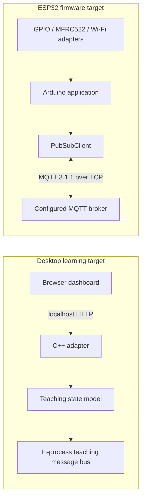

# Architecture

The repository has two execution targets with deliberately different claims.

## Desktop target

`desktop/src/simulator.cpp` models door state, authorization, timing and injected faults. `desktop/src/main.cpp` is a small localhost-only HTTP adapter; `desktop/web/index.html` is a browser UI. It is dependency-free and usable without an ESP32, PlatformIO, Wokwi or a broker.

The desktop message feed is intentionally an in-process software model. It visualizes topic names, retain flags, and QoS/LWT scenarios, but it does not implement MQTT packets or prove broker delivery semantics. Do not use its simulated heap or accelerated clock as device measurements.

## Firmware target

`src/` is the Arduino/ESP32 target. It uses real GPIO drivers, MFRC522, Wi-Fi STA, and PubSubClient to connect to the broker configured in `src/config.h`. `platformio.ini` pins the target board/framework and declares the external libraries. The connection and command logic run from the Arduino loop; Wi-Fi startup is asynchronous so local controls can continue while the network connects.

The firmware and desktop model are separate implementations today. The desktop checks are not hardware-in-the-loop or proof that the ESP32 behavior exactly matches the desktop model. A future improvement is extracting a shared allocation-light domain core and testing it on both targets.

## Important runtime properties

- Local button, RFID handling, serial commands and door timer are serviced independently of Wi-Fi availability.
- Timer comparisons use elapsed-time subtraction in firmware, which remains correct across `millis()` rollover for these short intervals.
- MQTT reconnect attempts are rate-limited; a successful connection subscribes to the command topic and publishes online/status messages.
- The firmware currently uses PubSubClient: ordinary `publish()` calls are QoS 0. Command subscription and the Last Will can use QoS 1. See [MQTT topic design](mqtt-topic-design.md).
- The demo whitelist is a prototype convenience, not production-grade identity or access control.
